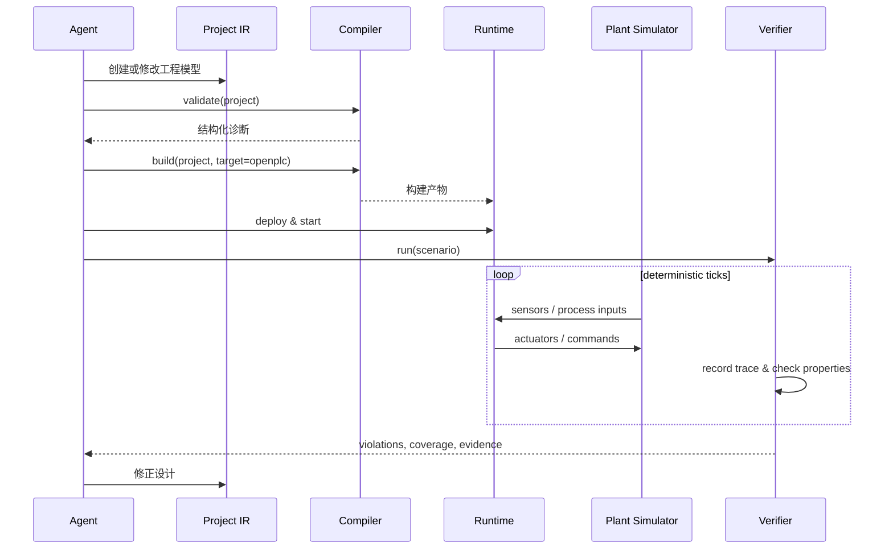

# 系统架构

## 模块边界

| 模块 | 责任 | 不负责 |
|---|---|---|
| `specs` | 保存工程语义与验收契约 | 编译、Runtime 状态 |
| `compiler` | 校验 IR，生成 ST、映射和构建清单 | 启停 PLC、运行仿真 |
| `runtime` | Runtime 生命周期、部署、变量与 Trace 接口 | 工艺建模 |
| `simulator` | 确定性设备与物料演化 | 生成 PLC 控制策略 |
| `verifier` | 场景编排、属性检查、覆盖率和报告 | 修改事实来源 |
| `web` | 人类查看、解释和受控操作 | 保存独立业务真相 |
| `adapters` | 厂商和外部工具协议转换 | 污染核心 IR |

## Plant 后端边界

`simulator` 是内建的确定性 Plant 后端，外部三维或专业仿真器属于
`adapters`。两者都通过 Canonical Plant Contract 与 Runtime/Verifier 交互：

```text
Runtime <-> I/O + scan metadata <-> Plant Contract <-> Plant backend
                                                    |- built-in simulator
                                                    |- browser/3D scene
                                                    |- physics simulator
                                                    `- process simulator
```

核心只依赖信号、时间、状态、故障和 Trace，不依赖外部模拟器的场景树、几何对象
或私有工程格式。详细分级和 Adapter 最小能力见
[仿真复杂度、阶段目标与边界](simulation-scope.md)。

## 数据流



## 单一事实来源

长期架构中，`specs/` 将成为手工与 Agent 共同维护的工程语义目录。当前实验阶段
暂不实现通用 IR；每个 `labs/` 实验的 ST、I/O 契约、测试和 Trace 是该实验的实际
事实来源。以下内容在未来统一契约落地后应成为可再生内容：

- 生成的 ST；
- OpenPLC 工程与 Modbus 配置；
- I/O CSV；
- HMI schema；
- LD/SFC 可视化；
- 测试轨迹；
- FAT 报告。

生成物写入 `artifacts/generated/`、`artifacts/traces/` 与 `artifacts/reports/`，不得反向成为隐式配置。

## 执行模型

第一版采用固定 tick 的离散时间模型：

1. Plant Simulator 计算当前传感器；
2. Runtime 执行一个或多个 PLC scan；
3. Plant Simulator 消费执行器输出；
4. Verifier 记录状态并检查不变量；
5. 虚拟时间推进。

线上 Runtime 不能保证逐 tick 锁步时，Adapter 必须记录实际时间、scan 序号和采样误差，Verifier 据此应用容差。

## 后端策略

### 第一阶段

- OpenPLC Runtime v4；
- Modbus TCP；
- Linux/Docker 开发环境；
- ST 作为主要生成语言。

### 第二阶段

- CODESYS Control for Linux；
- OPC UA；
- 外部 Factory I/O/Open Industry Project Adapter；
- LD 只读渲染与受约束编辑。

### 第三阶段

- Siemens/TIA 工程导出与验证；
- 厂商地址、指令和诊断映射；
- 真实 I/O 与 Hardware-in-the-loop；
- 安全部署审批与审计。

Plant 复杂度按单机、自动化单元、产线和小型工厂逐级扩展。高精度机器人动力学、
流体、热力和其他专业过程只通过外部 Plant Adapter 接入，不进入内建模拟器内核。

## 安全边界

工具执行分为四级：

| 等级 | 示例 | 默认策略 |
|---|---|---|
| Read | 读取工程、变量和 Trace | 自动允许 |
| Offline Write | 修改 IR、生成代码 | 允许并记录 diff |
| Simulated Control | 仿真强制信号、故障注入 | 允许并标记为仿真 |
| Physical Control | 部署真实 PLC、强制真实输出 | 策略检查和人工确认 |

任何 Adapter 都必须明确声明连接目标是 `simulation`、`softplc` 还是 `physical`。
